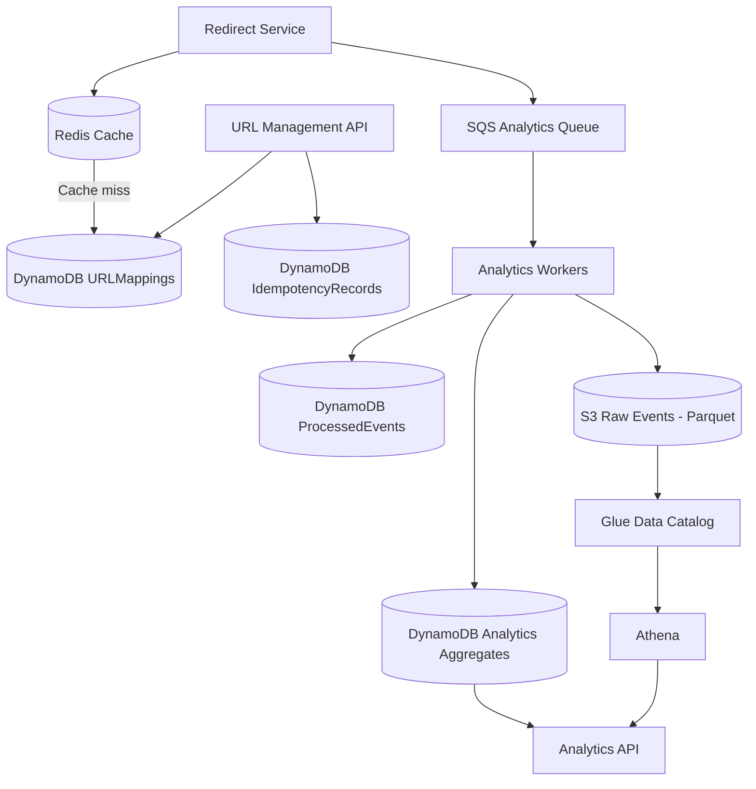

# DATABASE_DESIGN.md

# Database Design — Distributed URL Shortener

## 1. Purpose

This document defines the data architecture for a URL-shortening platform designed around these initial assumptions:

| Metric | Initial assumption |
|---|---:|
| Registered users | 10 million |
| Daily active users | 1 million |
| URLs stored | 50 million |
| Redirects per active user per day | 10 |
| Estimated redirects/day | 10 million |
| Average redirect throughput | ~116 requests/second |
| Illustrative peak (10× average) | ~1,160 requests/second |

These figures are planning assumptions, not measured production requirements.

The database architecture must support:

- Fast URL resolution.
- Efficient retrieval of URLs owned by a user.
- High-volume click-event ingestion.
- Analytics aggregation across multiple dimensions.
- Horizontal scaling.
- Event replay and recovery.
- Data expiration and retention.

## 2. Database technology choices

| Technology | Responsibility | Data characteristics |
|---|---|---|
| DynamoDB | URL mappings and operational aggregates | Key-value/document, low-latency access |
| Redis / ElastiCache | URL lookup cache | Temporary, frequently accessed data |
| S3 | Raw click-event storage | Durable, inexpensive object storage |
| Athena + Glue | Historical analytics | SQL queries over S3 data |
| SQS | Analytics event transport | Asynchronous message delivery |

### Why not one database for everything?

The platform has two fundamentally different workloads.

**Operational workload**

- Resolve a short code.
- Retrieve a user's URL list.
- Update a URL.
- Check whether a URL is active or expired.

These operations need predictable, low-latency access.

**Analytical workload**

- Count clicks by day.
- Group clicks by country.
- Compare devices and browsers.
- Analyze referrers.
- Produce historical time-series reports.

These operations scan and aggregate large datasets.

Using one database for both workloads would create competing access patterns. We separate them so that analytical queries do not interfere with redirect performance.

---

## 3. DynamoDB access patterns

Before designing tables, define the queries the application must execute.

| ID | Access pattern | Expected frequency |
|---|---|---|
| AP-01 | Retrieve URL mapping using short code | Extremely high |
| AP-02 | Create a new short URL | Medium |
| AP-03 | Update or deactivate a URL | Low |
| AP-04 | List URLs belonging to a user | Medium |
| AP-05 | Retrieve one URL's metadata | Medium |
| AP-06 | Retrieve daily analytics for a URL | High |
| AP-07 | Retrieve analytics grouped by country | High |
| AP-08 | Retrieve analytics grouped by device | High |
| AP-09 | Retrieve analytics grouped by browser | High |
| AP-10 | Retrieve analytics grouped by referrer | High |
| AP-11 | Prevent duplicate processing of an analytics event | High |
| AP-12 | Track request idempotency during URL creation | Medium |

The table and index design below is derived from these access patterns.

---

# 4. URLMappings table

## 4.1 Responsibility

Stores the authoritative mapping between a short code and its original URL.

The redirect service uses this table when a mapping is not present in Redis.

## 4.2 Primary key

| Attribute | Key type | Purpose |
|---|---|---|
| `short_code` | Partition key (PK) | Unique short identifier |

Example conceptual item:

| Attribute | Example |
|---|---|
| short_code | `aB91xYz2` |
| original_url | `https://example.com/articles/distributed-systems` |
| user_id | `user_123` |
| created_at | `2026-11-06T10:30:00Z` |
| updated_at | `2026-11-06T10:30:00Z` |
| expires_at | `1794000000` |
| is_active | `true` |
| custom_alias | `false` |

`short_code` is the partition key because the redirect operation starts with a short code. DynamoDB can retrieve the item directly using `GetItem`, without scanning the table.

## 4.3 Secondary index: UserURLsIndex

The dashboard needs to retrieve URLs belonging to a particular user.

A query against the primary key cannot efficiently answer this question because the primary key is `short_code`, not `user_id`.

We therefore add a Global Secondary Index (GSI).

| Index attribute | Key type |
|---|---|
| `user_id` | Partition key |
| `user_created_key` | Sort key |

Example `user_created_key`:

`2026-11-06T10:30:00Z#aB91xYz2`

This supports:

- Listing a user's URLs.
- Sorting URLs by creation time.
- Paginating through a user's URL collection.
- Retrieving a specific user's most recently created URLs.

The application should use DynamoDB's `Query` operation against this GSI, not `Scan`.

**Important:** GSI reads are eventually consistent. A newly created URL may not immediately appear in the user's listing. If the dashboard needs read-after-write behavior, the API can return the newly created item directly or retrieve it from the base table.

## 4.4 Uniqueness

The primary key guarantees that a short code identifies at most one item.

When creating a mapping:

1. Generate a candidate Base62 code.
2. Attempt to insert the item using a conditional write.
3. Require that the primary key does not already exist.
4. If the condition fails, generate another candidate.
5. Retry a bounded number of times.

Custom aliases use exactly the same uniqueness rule. A custom alias and a generated code cannot occupy the same key.

Do not rely on a separate "check whether code exists" request before inserting. Two concurrent requests could both observe that the code is unused. The conditional write is the actual uniqueness guarantee.

## 4.5 Expiration

The item may contain an `expires_at` Unix timestamp.

DynamoDB TTL can use this attribute to remove expired items eventually. However, TTL deletion is asynchronous.

Therefore:

- The redirect service must check `expires_at` itself.
- An expired mapping must never redirect merely because DynamoDB has not deleted it yet.
- The application must distinguish an expired URL from a nonexistent URL.
- Redis entries must not remain usable past the URL's expiration time.

Recommended behavior:

| Condition | Redirect response |
|---|---|
| Code does not exist | 404 Not Found |
| URL is inactive | 410 Gone |
| URL has expired | 410 Gone |
| URL is active and valid | 302 Found |

## 4.6 Important design constraint: GSI distribution

The `user_id` partition key is suitable for the user dashboard because requests are naturally scoped to individual users.

However, an extremely active account could produce a concentrated access pattern on one GSI partition-key value. Monitor this if the platform has accounts with unusually large URL collections or high dashboard traffic.

Do not introduce sharding preemptively without evidence. If it becomes necessary, a sharded user index can distribute a user's records across several partition-key values, at the cost of querying and merging multiple partitions.

---

# 5. Analytics data architecture

Analytics should not be stored as individual click records in the same operational table as URL mappings.

A redirect may generate a click event for every successful visit. At 10 million redirects per day, retaining every event as a DynamoDB item would create unnecessary operational storage and query pressure.

We separate analytics into two layers:

1. **Raw events:** durable, detailed click records in S3.
2. **Aggregates:** compact, query-oriented counters in DynamoDB.

S3 is the historical source for reprocessing and deeper analysis. DynamoDB aggregates serve common dashboard queries.

## 5.1 Raw click events

A click event is produced by the redirect service and sent to SQS.

Conceptual event structure:

| Field | Purpose |
|---|---|
| `event_id` | Globally unique event identifier |
| `short_code` | URL that was visited |
| `timestamp` | Event time |
| `country` | Approximate visitor country |
| `device_type` | Desktop, mobile, tablet, or unknown |
| `browser` | Browser category |
| `referrer` | Referring domain or classified source |
| `user_agent` | Optional; retain only if justified |
| `ip_hash` | Optional; avoid storing raw IP by default |

The event should be self-contained enough for the analytics worker to process it without querying the URL mapping table for every click.

### Event identity

`event_id` is essential.

SQS Standard queues provide at-least-once delivery. The same message can be delivered more than once.

Without event identity and deduplication, one click could increment analytics counters multiple times.

### Privacy

Do not collect more visitor information than the analytics features require.

In particular:

- Avoid raw IP storage by default.
- Define a retention policy for user-agent information.
- Normalize referrers instead of retaining unnecessary full URLs.
- Avoid putting sensitive visitor information into logs.
- Document how long raw and aggregated data are retained.

---

# 6. S3 raw-event data lake

## 6.1 Storage layout

Raw events should be written to S3 in time-based partitions.

Proposed layout:

` s3://<bucket>/click-events/year=2026/month=11/day=06/hour=10/part-....parquet `

The partition columns allow Athena to skip unrelated data when a query specifies a date range.

For example, a report for one URL covering the last seven days should not need to inspect every event stored since the platform launched.

## 6.2 File format

Use Parquet rather than storing long-term analytical data as individual JSON objects.

Parquet is columnar:

- Athena can read only the columns needed by a query.
- Compression reduces storage and scan costs.
- Column types are explicit.
- It is well suited to analytical workloads.

JSON can still be useful for initial debugging or temporary ingestion, but it should not become the long-term analytics storage format by accident.

## 6.3 Avoid tiny files

Do not write one Parquet file for every click.

That would create a large number of small objects and increase query-planning and metadata overhead.

Instead, analytics workers should buffer events and write batches based on a configured time or size threshold.

The correct threshold should be measured against ingestion delay, memory usage, query performance, and operational limits.

## 6.4 Glue and Athena

Glue maintains the table metadata and partition information.

Athena executes SQL queries over the S3 data.

Example analytical questions:

- How many clicks did a URL receive last month?
- Which countries generated the most traffic?
- What percentage of visitors used mobile devices?
- Which referrers generated the most traffic?
- How did daily traffic change over the last 90 days?

Athena is not part of the redirect request path. A slow historical query must not delay a redirect.

---

# 7. DynamoDB analytics aggregates

## 7.1 Why maintain aggregates?

The dashboard frequently requests summaries such as:

- Total clicks today.
- Clicks per day.
- Top countries.
- Device distribution.
- Browser distribution.
- Referrer distribution.

Recalculating these values from raw events for every dashboard request would be inefficient.

Workers therefore maintain precomputed counters.

## 7.2 Proposed logical key structure

A conceptual aggregate item has:

| Attribute | Purpose |
|---|---|
| `PK` | URL, date, and shard identifier |
| `SK` | Metric name and dimension value |
| `count` | Number of events |
| `updated_at` | Last update timestamp |

Example keys:

| PK | SK | Count |
|---|---|---:|
| `URL#aB91xYz2#DAY#2026-11-06#SHARD#03` | `METRIC#TOTAL` | 1200 |
| `URL#aB91xYz2#DAY#2026-11-06#SHARD#03` | `METRIC#COUNTRY#IN` | 500 |
| `URL#aB91xYz2#DAY#2026-11-06#SHARD#03` | `METRIC#DEVICE#MOBILE` | 750 |
| `URL#aB91xYz2#DAY#2026-11-06#SHARD#03` | `METRIC#BROWSER#CHROME` | 650 |

This is a logical design, not yet a finalized physical schema.

## 7.3 Why shard aggregate keys?

Imagine a popular URL receives a very large number of clicks.

If every worker updates the same daily counter item, that item becomes a concentrated write target.

This creates a hot-key risk.

Instead, distribute increments across a fixed number of shards:

- Shard 00
- Shard 01
- Shard 02
- ...
- Shard N

The worker selects a shard using a deterministic function of the event identifier.

A dashboard query retrieves all shards for the requested URL and date, then sums the counters.

Trade-off:

| Without sharding | With sharding |
|---|---|
| Simpler reads | More complex reads |
| Concentrated writes | Distributed writes |
| Easier aggregation | Requires summing shards |
| Higher hot-key risk | Reduced hot-key concentration |

The shard count should be selected using measured traffic and write capacity, not guessed once and treated as permanent.

## 7.4 A limitation of the proposed key structure

The structure above is useful for retrieving all metrics for a URL and day. However, it is not automatically optimal for every dashboard query.

For example, querying the top countries across 30 days requires reading the relevant daily aggregate items and combining them.

That is acceptable for a modest number of days and dimensions. It may become expensive for long date ranges or very popular URLs.

A future optimization could maintain additional precomputed views, such as:

- Monthly aggregates.
- Top-N country summaries.
- Top-N referrer summaries.
- User-level dashboard summaries.

Do not build every possible aggregate at the beginning. Each additional materialized view creates write amplification and consistency complexity.

---

# 8. Event processing and idempotency

## 8.1 The duplicate-delivery problem

SQS Standard queues can deliver a message more than once.

Example:

1. Worker receives event `evt-123`.
2. Worker increments the daily counter.
3. Worker crashes before deleting the SQS message.
4. SQS delivers `evt-123` again.
5. The counter may be incremented twice.

The worker must therefore implement idempotent processing.

## 8.2 Processed-event tracking

A possible design uses a separate DynamoDB table:

### ProcessedEvents

| Attribute | Purpose |
|---|---|
| `event_id` | Partition key |
| `processed_at` | Processing timestamp |
| `expires_at` | Optional TTL for deduplication records |

The worker uses a conditional write to claim an event identifier only if it has not already been processed.

However, there is an important issue: claiming the event and updating analytics aggregates are separate operations.

A worker could successfully record the event as processed and then crash before updating the aggregate. On retry, it would see the event as processed and skip it, permanently losing that increment.

Therefore, a simple "mark processed, then increment" sequence is not sufficient.

## 8.3 Safer processing strategy

Use an explicitly recoverable processing design.

One practical approach:

1. Receive the SQS event.
2. Persist the raw event to durable storage using a deterministic event identity or an ingestion manifest.
3. Update aggregate counters through an idempotent processing mechanism.
4. Record completion only after the required writes have succeeded.
5. Delete the SQS message after successful processing.
6. If processing fails, allow retry and make replay safe.

For a robust implementation, separate raw-event durability from aggregate generation:

- Raw events are the replayable source.
- Aggregate updates are derived state.
- Failed aggregate processing can be replayed from raw events.
- Deduplication is enforced during aggregate generation.

This avoids treating a successful S3 write and a successful DynamoDB update as though they were one atomic transaction. They are not.

A later implementation decision must specify the exact checkpoint and recovery protocol, including how duplicate S3 ingestion is handled.

## 8.4 SQS visibility timeout and dead-letter queue

Configure:

- Visibility timeout long enough for normal batch processing.
- Retry policy for transient failures.
- Dead-letter queue (DLQ) for repeatedly failing messages.
- Monitoring for message age and DLQ depth.

A message that repeatedly fails should not block healthy events indefinitely.

---

# 9. URL creation idempotency

A separate issue exists in URL creation.

Suppose a client sends a create request, the server creates the mapping, but the response is lost. The client retries and might create a second short URL for the same request.

If the API promises idempotent creation, introduce an idempotency mechanism.

### IdempotencyRecords

| Attribute | Purpose |
|---|---|
| `user_id` | Partition-key component |
| `idempotency_key` | Sort-key component |
| `request_hash` | Detect reuse with different request data |
| `short_code` | Original operation's result |
| `created_at` | Creation timestamp |
| `expires_at` | Optional TTL |

A repeated request with the same user and idempotency key should return the original result.

If the same key is reused with different request content, return a conflict rather than silently treating it as the original request.

The exact creation flow must coordinate the idempotency record and URL mapping. A DynamoDB transaction may be appropriate if both writes need atomicity.

---

# 10. Redis cache design

Redis is a cache, not the source of truth.

## 10.1 Key structure

| Redis key | Value |
|---|---|
| `url:aB91xYz2` | Cached URL mapping |
| `url:customname` | Cached URL mapping |
| `url:missing:unknown123` | Optional negative-cache marker |

## 10.2 Cache-aside flow

1. Redirect service receives a short code.
2. Look up `url:<short_code>` in Redis.
3. If found, validate active and expiration state and redirect.
4. If absent, retrieve the mapping from DynamoDB.
5. If the mapping exists and is valid, cache it.
6. Return the redirect.

## 10.3 Cache invalidation

When a URL is updated or deactivated:

1. Update DynamoDB.
2. Invalidate the corresponding Redis entry.
3. Ensure the redirect service does not continue using stale data beyond the accepted consistency window.

For stronger correctness, consider versioned cache entries or a carefully defined invalidation protocol.

The system must define what happens if DynamoDB is updated successfully but Redis invalidation fails. A short cache TTL provides a bounded fallback, but it does not make invalidation immediate.

## 10.4 TTL policy

Cache TTL should account for:

- URL expiration time.
- Expected update frequency.
- Acceptable stale-data window.
- Popularity and cache memory pressure.

For an expiring URL, the cache TTL must never extend beyond the URL's remaining lifetime.

Negative caching can reduce repeated DynamoDB reads for nonexistent codes, but use a short TTL. Otherwise, a newly created mapping could remain temporarily invisible to the redirect service.

## 10.5 Cache stampede

A popular cache entry may expire and cause many simultaneous requests to query DynamoDB.

Possible mitigations:

- Refresh popular entries before expiration.
- Add randomized TTL variation.
- Use request coalescing for concurrent misses.
- Apply short-lived locks where justified.

Do not introduce distributed locking unless measurements show it is needed.

---

# 11. Pagination and query behavior

## 11.1 User URL listing

The URL dashboard uses `UserURLsIndex`.

Use DynamoDB's `LastEvaluatedKey` as the basis for pagination.

The API should return an opaque continuation token rather than expose internal DynamoDB key details directly.

The token should be validated and bound to the authenticated user's query context.

## 11.2 Analytics time ranges

For daily aggregates, a dashboard request covering a range of dates should query each required date and sum the relevant shards.

For larger ranges, use monthly aggregates or Athena, depending on the required latency and data volume.

Define limits on:

- Maximum date range for interactive aggregate queries.
- Maximum page size.
- Maximum number of dimensions returned.
- Maximum number of concurrent historical queries.

Do not allow arbitrary unbounded analytical requests to overload the operational data path.

---

# 12. Consistency model

Different parts of the system have different consistency requirements.

| Data | Expected consistency |
|---|---|
| Short-code uniqueness | Strongly enforced through conditional writes |
| URL mapping read | Strongly consistent base-table read available when required |
| User URL GSI listing | Eventually consistent |
| Redis cache | Potentially stale until invalidation or TTL |
| SQS event delivery | At least once |
| Analytics aggregates | Eventually consistent |
| Athena historical results | Depends on ingestion and catalog freshness |

The platform should not promise real-time analytics if events are processed asynchronously.

A dashboard may show a slightly delayed click count. That is an intentional trade-off to keep redirects fast and decouple analytics from the critical path.

---

# 13. Backup, recovery, and retention

## DynamoDB

Plan for:

- Point-in-time recovery.
- On-demand backups.
- Restore testing.
- Monitoring consumed capacity and throttling.
- A documented recovery procedure.

## S3

Plan for:

- Versioning where appropriate.
- Lifecycle policies.
- Encryption at rest.
- Restricted bucket access.
- Retention and deletion policies.
- Recovery from accidental deletion.

## Redis

Redis data is reconstructable from DynamoDB, so it should not be treated as the only copy of any URL mapping.

## Analytics

Raw events should be retained according to an explicit policy. Since aggregates can be rebuilt from raw events, the raw-event dataset is important for recovery and analytical corrections.

A retention policy must balance replay requirements, storage cost, and privacy obligations.

---

# 14. Capacity and scaling considerations

The initial workload estimate is approximately 10 million redirects per day.

At that volume:

- Redirect reads will dominate URL mapping access.
- Redis should absorb a substantial portion of repeated lookups if traffic has a meaningful popularity distribution.
- DynamoDB must handle cache misses and URL management operations.
- SQS decouples redirect traffic from analytics processing.
- S3 handles long-term event retention.
- Aggregate writes need protection against hot keys.

The average redirect rate alone is not enough to size infrastructure.

Measure:

- Peak requests per second.
- Distribution of requests across short codes.
- Cache hit ratio.
- DynamoDB read/write consumption.
- SQS message age and backlog.
- Event-processing throughput.
- Aggregate write contention.
- Athena bytes scanned per query.

A system with 1,160 requests per second distributed evenly across millions of URLs behaves differently from one where a few URLs receive most of the traffic.

The popularity distribution is therefore a major load-testing variable.

---

# 15. Decisions to validate before implementation

These are deliberately left open until access patterns and tests justify a choice.

| Decision | Initial direction | Validation required |
|---|---|---|
| DynamoDB capacity mode | On-demand initially | Cost and sustained throughput |
| User GSI sharding | No initial sharding | Large-account traffic |
| Aggregate shard count | Configurable | Hot-key load testing |
| Aggregate dimensions | Country, device, browser, referrer | Cardinality and dashboard needs |
| Raw event buffering | Batched Parquet writes | Latency and file-size tests |
| Deduplication retention | Bounded retention | Maximum retry/replay window |
| Historical analytics | Athena | Query latency and scan cost |
| Cache TTL | Workload-dependent | Staleness and hit ratio |
| Aggregate granularity | Daily initially | Dashboard time-range requirements |

---

# 16. Final database architecture

## Core design principles

1. DynamoDB is the source of truth for URL mappings.
2. Redis accelerates reads but is always reconstructable.
3. SQS keeps analytics processing out of the redirect request path.
4. S3 stores durable raw events for replay and historical analysis.
5. DynamoDB aggregates serve common dashboard queries.
6. Event processing must be idempotent and recoverable.
7. Partition keys must distribute traffic rather than concentrate it.
8. TTL is cleanup, not application-level expiration enforcement.
9. Interactive analytics and historical analytics use different query paths.
10. Every scaling decision must be validated under realistic traffic distributions.

**Status:** Database design drafted. The physical aggregate schema, event-processing checkpoint protocol, and capacity settings remain implementation decisions to validate through testing.