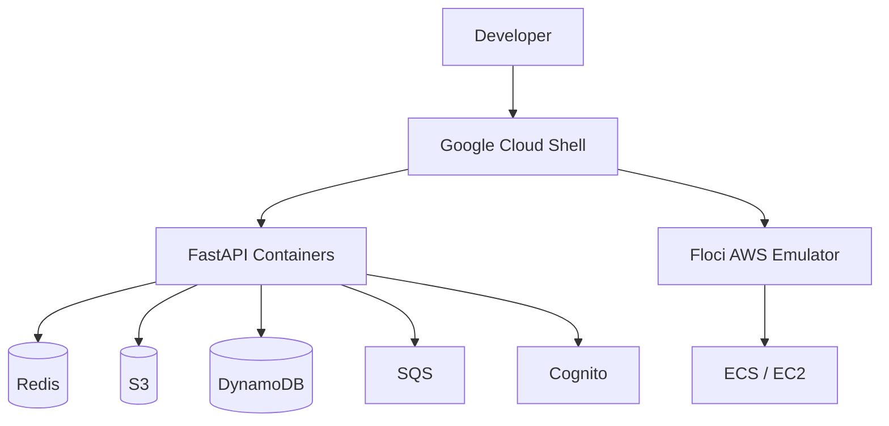
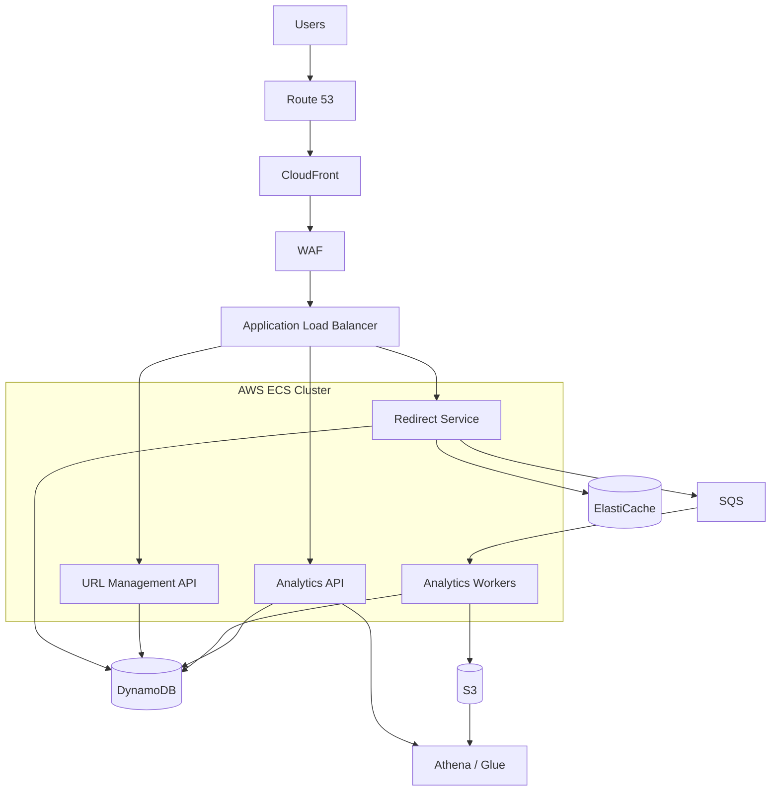

# INFRASTRUCTURE_PLAN.md

# Infrastructure Foundation — Distributed URL Shortener

## 1. Development environment

### Primary environment

| Component | Choice |
|---|---|
| Terminal | Google Cloud Shell browser terminal |
| AWS emulator | Floci |
| Container runtime | Docker |
| Cloud APIs | AWS CLI |
| Application language | Python |
| Backend framework | FastAPI |
| Infrastructure as Code | Terraform |
| Version control | Git |

The application and Floci should run in the same environment initially. This avoids unnecessary networking and SSH complications.

### Fallback environment

If Cloud Shell becomes inconvenient or resource-constrained:

- Run Floci locally.
- Run FastAPI locally.
- Run Redis locally when needed.
- Use Docker Compose only when multiple services need coordinated startup.

The application must not depend on Google Cloud Shell-specific functionality.

**Portability requirement:** Switching from Cloud Shell to a local machine should require configuration changes, not application rewrites.

---

## 2. Infrastructure architecture

### Development architecture

This is a logical architecture. Not every component needs to run immediately.

### Production architecture

---

## 3. Floci compatibility matrix

The following is the initial compatibility assessment based on Floci's documented service list. Actual operations must be tested.

| AWS service | Project use | Priority | Initial status |
|---|---|---:|---|
| S3 | Raw analytics events | High | Already tested |
| DynamoDB | URL mappings and aggregates | High | Already tested |
| EC2 | Compute learning | Medium | Already tested |
| SQS | Analytics event queue | High | Verify next |
| ElastiCache | Redis caching | High | Verify |
| Cognito | User authentication | High | Verify |
| ECR | Container image registry | Medium | Verify |
| ECS | Container orchestration | Medium | Verify |
| ELB v2 | Load balancing | Medium | Verify |
| Athena | Historical analytics | Medium | Verify |
| Glue | Analytics catalog | Medium | Verify |
| CloudWatch | Monitoring | Medium | Verify |
| WAF | Traffic protection | Later | Verify |
| CloudFront | CDN | Later | Verify |
| Route 53 | DNS | Later | Verify |

Floci documents support for these services, but service-level availability does not guarantee complete API compatibility or identical AWS behavior.

---

## 4. Learning and implementation order

We should not try to learn every service simultaneously.

### Stage 1 — Storage and messaging

Already covered:

- S3
- DynamoDB

Next:

- SQS

Why SQS comes next:

The redirect service must publish click events without waiting for analytics processing.

We need to understand:

- Standard versus FIFO queues.
- Visibility timeout.
- Message retention.
- Long polling.
- Dead-letter queues.
- At-least-once delivery.
- Duplicate message processing.

**Project outcome:** A working asynchronous event pipeline.

### Stage 2 — Caching

Learn:

- Redis data structures.
- Key expiration.
- TTL.
- Cache-aside.
- Cache invalidation.
- Cache stampede.
- Redis failure and fallback.

**Project outcome:** Fast URL resolution with Redis and DynamoDB fallback.

### Stage 3 — Authentication

Learn Cognito:

- User pools.
- App clients.
- JWT access tokens.
- JWKS.
- Token validation.
- User identity and authorization.

**Project outcome:** Authenticated URL creation and user-owned dashboards.

### Stage 4 — Containers

Learn:

- Docker images.
- Container networking.
- Environment variables.
- Health checks.
- Container resource limits.
- ECR image storage.
- ECS task definitions.
- ECS services.
- Load balancing.

**Project outcome:** Independently deployable FastAPI services.

### Stage 5 — Analytics

Learn:

- S3 partitioning.
- Parquet.
- Glue catalog.
- Athena SQL.
- Aggregate tables.
- Event replay.

**Project outcome:** Historical analytics and dashboard reporting.

### Stage 6 — Infrastructure and observability

Learn:

- Terraform.
- CloudWatch.
- IAM task roles.
- Auto Scaling.
- ALB health checks.
- WAF.
- CloudFront.

**Project outcome:** A production-oriented infrastructure deployment.

---

## 5. Infrastructure boundaries

We will keep the following responsibilities separate:

| Component | Responsibility |
|---|---|
| Floci | Emulates AWS services |
| Docker | Runs application containers and supporting services |
| FastAPI | Implements application logic |
| Terraform | Defines infrastructure resources |
| AWS CLI | Interacts with AWS-compatible service APIs |
| Git | Tracks project changes |

Floci is not the application runtime. FastAPI remains our application.

Docker is not a replacement for ECS. Docker runs containers; ECS manages container deployment, scheduling, and service operation.

Terraform defines infrastructure. It does not replace Docker or FastAPI.

---

## 6. Configuration strategy

The application should use configuration for service endpoints rather than hardcoding Floci addresses.

Conceptual configuration:

| Setting | Development example |
|---|---|
| AWS region | `us-east-1` |
| AWS endpoint | `http://localhost:4566` |
| S3 bucket | `url-shortener-events` |
| DynamoDB URL table | `URLMappings` |
| SQS queue | `url-click-events` |
| Redis endpoint | Configurable |
| Cognito pool | Configurable |

The endpoint shown is valid when the application can reach Floci through localhost—for example, when both run in the same environment.

If the application and Floci run on different machines, their networking configuration must be adjusted.

Production configuration will use actual AWS endpoints rather than the local emulator endpoint.

Secrets must be supplied through environment variables or a secrets manager, never committed to Git.

---

## 7. Infrastructure validation strategy

Every new service must pass a small integration test before the application depends on it.

| Service | Validation |
|---|---|
| S3 | Create bucket, upload, retrieve and delete object |
| DynamoDB | Create table, write, query, update and delete item |
| SQS | Create queue, send, receive and delete message |
| Redis | Set, retrieve, expire and delete key |
| Cognito | Create user pool, authenticate and validate token |
| ECR | Create repository and push image |
| ECS | Register task definition and run service |
| ELB v2 | Create load balancer and test routing |
| Athena | Create/query table backed by S3 data |

A successful resource creation alone is not sufficient. Test the exact operations the project needs.

---

## 8. Resource and environment discipline

Google Cloud Shell is a development environment, not our production hosting environment.

We will:

- Avoid unnecessary background containers.
- Avoid running all infrastructure components simultaneously before needed.
- Keep application and infrastructure configuration in Git.
- Avoid relying on temporary shell state.
- Save important work outside ephemeral runtime state.
- Use small integration tests before larger workloads.
- Avoid treating Cloud Shell performance as a production benchmark.

For load testing, use a controlled local environment or dedicated infrastructure later.

---

## 9. Milestone 1 completion criteria

Milestone 1 is complete when:

- Floci is running reliably in the chosen environment.
- S3 and DynamoDB integration are verified.
- SQS integration is verified.
- The application can reach its configured AWS endpoint.
- Redis integration is tested.
- The infrastructure configuration is portable.
- The required local services can be started and stopped predictably.
- The project has a reproducible development setup.

**Status:** Infrastructure plan drafted. Implementation begins with SQS integration, followed by Redis.