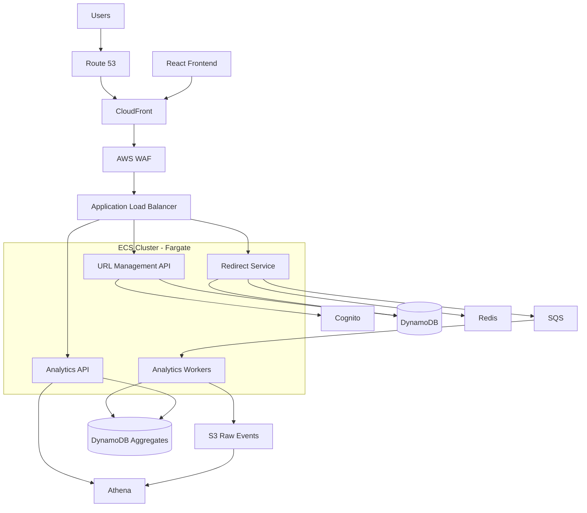
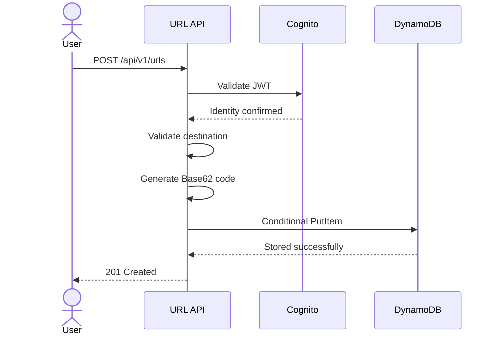
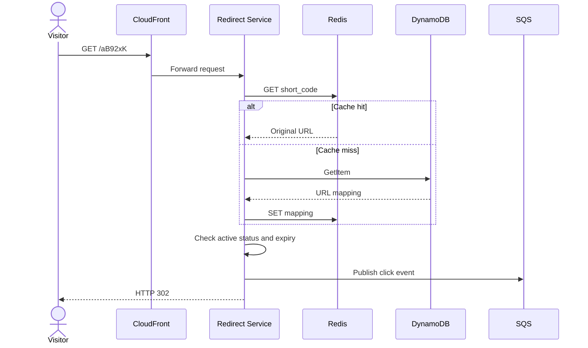
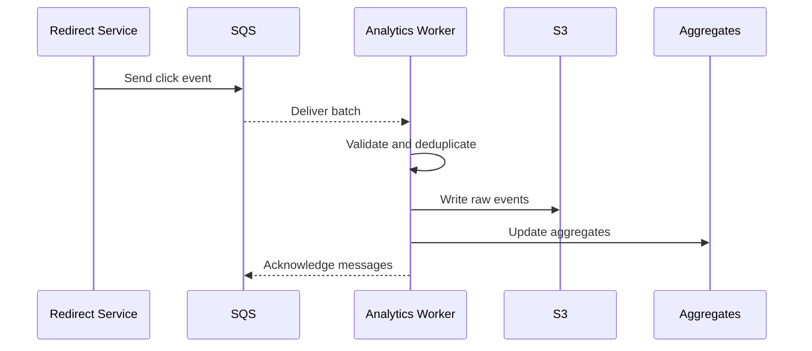

# URL Shortener — System Design

**Project:** Distributed URL Shortening Platform  
**Architecture:** Containerized, service-oriented architecture  
**Backend:** Python + FastAPI  
**Infrastructure:** AWS-compatible infrastructure using Floci  
**Production target:** 10 million registered users  
**Status:** Architecture and design phase

---

# 1. Project Overview

## 1.1 Objective

Build a scalable URL-shortening platform capable of supporting millions of registered users, millions of stored URLs, and high-volume redirect traffic.

The system should provide:

- URL shortening and redirection.
- User authentication and authorization.
- Custom short URLs.
- URL expiration and management.
- Advanced click analytics.
- Geographic and device-based analytics.
- Horizontally scalable application services.
- Asynchronous event processing.
- Monitoring and fault tolerance.

The primary engineering objective is to understand and implement distributed-system architecture, container orchestration, database design, caching, messaging, and cloud infrastructure.

## 1.2 Design assumptions

Initial capacity assumptions:

| Metric | Planning assumption |
|---|---:|
| Registered users | 10 million |
| Daily active users | 1 million |
| Stored URLs | 50 million |
| Redirects per active user/day | 10 |
| Average redirects/day | 10 million |
| Average redirect throughput | 116 RPS |
| Hypothetical peak multiplier | 10x |
| Peak redirect throughput | 1,160 RPS |
| Initial availability objective | 99.9% |

These are planning assumptions, not measured requirements.

---

# 2. Technology Stack

| Layer | Technology |
|---|---|
| Frontend | React |
| Backend | FastAPI |
| Programming language | Python |
| Containerization | Docker |
| Local orchestration | Docker Compose |
| Cloud orchestration | AWS ECS + Fargate |
| Load balancing | Application Load Balancer |
| Database | DynamoDB |
| Cache | Redis / ElastiCache |
| Messaging | Amazon SQS |
| Authentication | Amazon Cognito |
| Object storage | Amazon S3 |
| Analytics queries | Amazon Athena |
| CDN | CloudFront |
| DNS | Route 53 |
| Security | AWS WAF |
| Infrastructure as Code | Terraform |
| Monitoring | CloudWatch |
| Performance testing | k6 |
| Version control | Git + GitHub |

---

# 3. High-Level Architecture

## 3.1 Architecture diagram



## 3.2 Architectural principles

### Separation of responsibilities

Each service should have a clearly defined responsibility.

### Horizontal scalability

Services should be stateless wherever possible, allowing multiple instances to execute independently.

### Asynchronous processing

Non-critical operations should not block latency-sensitive requests.

### Independent scaling

Redirect traffic should not force analytics workers or URL management services to scale unnecessarily.

### Fault isolation

Failure in analytics should not bring down URL creation or redirection.

### Infrastructure reproducibility

Infrastructure should be defined through Terraform rather than configured manually.

---

# 4. Service Architecture

## 4.1 URL Management Service

**Technology:** FastAPI + Docker

Responsibilities:

- Create shortened URLs.
- Generate short codes.
- Validate destination URLs.
- Manage custom aliases.
- Update URL settings.
- Delete/deactivate URLs.
- Retrieve URLs belonging to a user.
- Enforce URL ownership.

Dependencies:

- DynamoDB.
- Cognito JWT validation.

Scaling:

- Horizontal scaling through ECS.
- Scale based on CPU, memory, and request load.

## 4.2 Redirect Service

**Technology:** FastAPI + Docker

This is the most performance-sensitive service.

Responsibilities:

1. Receive a short-code request.
2. Validate the short code.
3. Check Redis.
4. Query DynamoDB on cache miss.
5. Validate active status and expiration.
6. Publish click event to SQS.
7. Return an HTTP redirect.

Dependencies:

- Redis.
- DynamoDB.
- SQS.

Scaling:

- Independent ECS service.
- Horizontal scaling.
- Cache optimization.
- Load balancing.

The redirect service should not depend on the analytics processing pipeline being operational.

## 4.3 Analytics Worker

**Technology:** Python + Docker

Responsibilities:

- Consume SQS messages.
- Validate events.
- Deduplicate events.
- Batch events.
- Write raw events to S3.
- Update aggregated analytics.
- Handle failed messages.

Scaling:

- Scale according to SQS queue depth and message age.
- Use batch consumption.
- Apply idempotent processing.

## 4.4 Analytics API

**Technology:** FastAPI + Docker

Responsibilities:

- Retrieve click statistics.
- Provide geographical reports.
- Provide device and browser breakdowns.
- Retrieve referral information.
- Generate time-series data.
- Provide dashboard summaries.

Dependencies:

- DynamoDB aggregate tables.
- Athena for historical queries.

Scaling:

- Independent ECS service.
- Cache expensive report results where appropriate.

---

# 5. Request Lifecycle

## 5.1 URL Creation



Important considerations:

- Authentication is required.
- Generate a unique identifier.
- Use conditional writes to prevent collisions.
- Support idempotency keys to protect against duplicate creation after client retries.
- Store ownership information.

## 5.2 URL Redirection



CloudFront caching of redirects will initially be disabled.

We must not allow edge caching to bypass our click-event pipeline until we implement an appropriate edge analytics mechanism.

## 5.3 Analytics Processing



For reliable processing, we must carefully coordinate S3 writes, aggregate updates, and SQS acknowledgements.

We cannot assume a single transaction spans all three systems. We'll use durable event identifiers, idempotent aggregation, and retry-safe processing.

---

# 6. Short-Code Generation

## 6.1 Algorithm

Use Base62:

```text
Characters:
0123456789
abcdefghijklmnopqrstuvwxyz
ABCDEFGHIJKLMNOPQRSTUVWXYZ
```

Initial identifier length: 8 characters.

Possible identifier combinations:

62^8 = 218,340,105,584,896

## 6.2 Collision prevention

Use conditional writes in DynamoDB.

Conceptual process:

1. Generate random identifier.
2. Attempt conditional insertion.
3. If the identifier already exists, generate another.
4. Retry with a bounded retry policy.
5. Return an error if generation repeatedly fails.

Custom aliases must follow the same uniqueness constraint.

---

# 7. Database Architecture

## 7.1 URL Mapping Table

Table: `URLMappings`

Primary partition key:

`short_code`

Attributes:

| Attribute | Description |
|---|---|
| short_code | Unique short identifier |
| original_url | Original destination |
| user_id | Owner |
| created_at | Creation timestamp |
| updated_at | Last modification |
| expires_at | Optional expiration |
| is_active | URL status |
| custom_alias | Custom alias indicator |

Global Secondary Index:

`UserURLsIndex`

- Partition key: `user_id`
- Sort key: `created_at#short_code`

Purpose: Efficiently retrieve a user's URLs in creation order.

Pagination should use DynamoDB's continuation key rather than loading every URL into memory.

## 7.2 Analytics Aggregate Table

Table: `URLAnalytics`

Conceptual partition key:

`URL#short_code#DAY#YYYY-MM-DD`

Sort key:

`METRIC#dimension#value`

Example:

```text
PK: URL#aB92xK#DAY#2026-11-06
SK: METRIC#DEVICE#MOBILE
```

Other dimensions:

- COUNTRY
- BROWSER
- REFERRER
- DEVICE

Store aggregate counters and relevant time-bucket information.

For very popular URLs, partitioning must be designed to avoid hot keys.

## 7.3 Raw Event Storage

S3 structure:

```text
analytics/
    year=2026/
        month=11/
            day=06/
                hour=18/
                    events-001.parquet
```

Use Parquet for efficient analytical queries.

Athena will query historical events using Glue catalog metadata.

---

# 8. Caching Strategy

Use the cache-aside pattern.

```text
Request
   |
   v
Redis lookup
   |
   +---- Cache hit ----> Return destination
   |
   +---- Cache miss ---> DynamoDB lookup
                              |
                              v
                         Populate Redis
                              |
                              v
                       Return destination
```

Initial cache policies:

- TTL based on URL update/expiration requirements.
- Explicit invalidation when destination changes.
- Negative caching for nonexistent identifiers with short TTL.
- Protection against cache stampedes.
- Redis failure fallback to DynamoDB.

Never allow Redis to become the source of truth.

---

# 9. API Specification Overview

Base URL:

`https://api.example.com/api/v1`

| Method | Endpoint | Description |
|---|---|---|
| POST | /urls | Create URL |
| GET | /urls | List user's URLs |
| GET | /urls/{code} | Retrieve URL details |
| PATCH | /urls/{code} | Modify URL |
| DELETE | /urls/{code} | Deactivate URL |
| GET | /analytics/{code} | Retrieve URL analytics |
| GET | /analytics/overview | Retrieve user analytics |

Redirect domain:

`https://short.example.com/{code}`

Expected redirect response:

`302 Found`

Additional API details, request schemas, response schemas, and error contracts will be defined in `API_SPECIFICATION.md`.

---

# 10. Authentication and Security

## Authentication

Use Cognito for:

- Registration.
- Login.
- Token issuance.
- Password recovery.
- Account verification.

FastAPI validates access-token signatures, issuer, audience/client claims, and expiration.

## Authorization

Users can only manage URLs they own.

Never trust `user_id` supplied in a request body as proof of ownership.

## URL validation

- Allow HTTP and HTTPS destinations.
- Reject unsupported schemes.
- Reject malformed URLs.
- Never execute destination URLs.
- Apply abuse and reputation checks.
- Protect any server-side URL inspection mechanism against SSRF.

## Rate limiting

Introduce limits for:

- Account registration.
- URL creation.
- Custom alias attempts.
- Redirect abuse.
- Analytics requests.

## Privacy

- Avoid storing raw IP addresses by default.
- Minimize user-agent retention.
- Define event retention policies.
- Provide an appropriate privacy and deletion process.

---

# 11. Fault Tolerance

| Failure | Expected behavior |
|---|---|
| Redis unavailable | Fall back to DynamoDB |
| DynamoDB unavailable | Return controlled service error |
| SQS unavailable | Continue redirect; report lost analytics event |
| Analytics worker crashes | SQS retries delivery |
| Duplicate event | Idempotent processing |
| Invalid short code | HTTP 404 |
| Expired URL | HTTP 410 |
| Deactivated URL | HTTP 410 |
| Cognito unavailable | Authentication operations fail safely |
| Container unhealthy | ECS replaces unhealthy task |

We will distinguish transient failures from permanent failures and configure bounded retries with backoff.

---

# 12. Deployment Architecture

## Development

- Windows development workstation.
- MobaXterm for SSH access.
- Existing Cloud Shell environment.
- Docker.
- Floci AWS emulator.
- Docker Compose.
- Terraform.

## Production

```text
Internet
   |
Route 53
   |
CloudFront + WAF
   |
Application Load Balancer
   |
ECS Cluster
   |
   +-- URL API Tasks
   +-- Redirect Tasks
   +-- Analytics API Tasks
   +-- Analytics Worker Tasks
   |
   +-- DynamoDB
   +-- ElastiCache
   +-- SQS
   +-- S3
   +-- Athena
   |
CloudWatch
```

Use multiple Availability Zones for production services.

Use private subnets for application containers and databases wherever possible.

Use IAM task roles instead of embedding AWS credentials in containers.

---

# 13. Observability

Monitor:

## Application metrics

- Requests per second.
- HTTP error rate.
- Redirect latency.
- URL creation latency.
- Authentication failures.

## Infrastructure metrics

- ECS CPU and memory.
- Desired versus running task count.
- ALB target health.
- DynamoDB throttling.
- Redis memory and connections.
- SQS queue depth.
- Oldest message age.

## Analytics metrics

- Events received.
- Events processed.
- Duplicate events.
- Failed event batches.
- Aggregation delay.
- Raw-event storage failures.

Use structured logs with correlation IDs and distributed tracing where practical.

---

# 14. Performance Targets

Initial objectives:

| Metric | Target |
|---|---|
| Redirect p95 latency | Below 100 ms |
| Availability | 99.9% |
| Cache hit ratio | Above 90% under a suitable workload |
| API error rate | Below 0.1% under target load |
| Analytics processing | No sustained backlog |
| Aggregate correctness | No duplicate counting |

These objectives must be validated with actual performance testing.

Testing will include:

- Normal traffic.
- Gradual traffic increases.
- Sudden traffic spikes.
- Hot-key workloads.
- Cache cold starts.
- Redis failures.
- SQS backlog.
- Database throttling.
- Container termination.

---

# 15. Architectural Constraints and Decisions

1. Use containers rather than Lambda for backend execution.
2. Use FastAPI for backend services.
3. Keep services independently deployable.
4. Avoid unnecessary microservice fragmentation.
5. Use DynamoDB as the operational source of truth.
6. Use Redis as a disposable cache.
7. Keep analytics asynchronous.
8. Keep raw analytics data separate from operational data.
9. Do not depend on CloudFront redirect caching initially.
10. Do not treat Floci benchmarks as production AWS benchmarks.
11. Use Terraform for reproducible infrastructure.
12. Do not claim 10-million-user capacity without validated workload tests.

---

# 16. Development Milestones

| Milestone | Deliverable |
|---|---|
| 0 | System design |
| 1 | Infrastructure foundation |
| 2 | URL creation service |
| 3 | Redirect service |
| 4 | Authentication and frontend |
| 5 | Advanced analytics |
| 6 | ECS container orchestration |
| 7 | Security and reliability |
| 8 | Load and stress testing |
| 9 | Production readiness |

---

# 17. Future Architecture Improvements

These are not part of the initial implementation.

Potential future enhancements:

- Edge-based redirects.
- Geographic routing.
- Multi-region deployment.
- DynamoDB Global Tables.
- Dedicated analytical warehouses.
- Stream-processing architecture.
- Advanced bot detection.
- Bloom filters for negative lookups.
- Distributed rate limiting.
- Custom domain support.
- Disaster recovery automation.

These should be introduced only when requirements justify them.

---

# 18. Definition of Success

The project is successful when:

1. Users can register and manage their shortened URLs.
2. Redirects work reliably.
3. Popular URLs benefit from caching.
4. Analytics are processed asynchronously.
5. Duplicate events do not corrupt aggregates.
6. Application services can scale independently.
7. Infrastructure is reproducible through Terraform.
8. Failure scenarios are tested.
9. Performance targets are measured.
10. A production deployment can be validated against the 10-million-user design assumptions.

**Final principle:** Design for scalability, implement incrementally, and validate every architectural claim through measurements.
